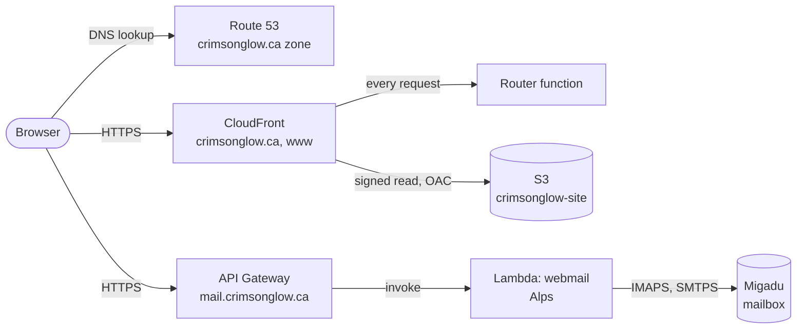
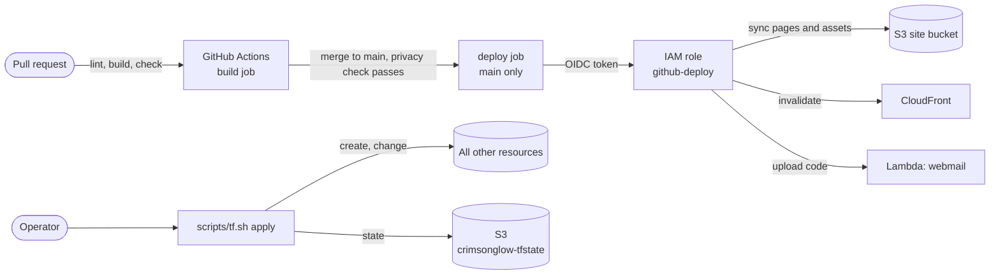
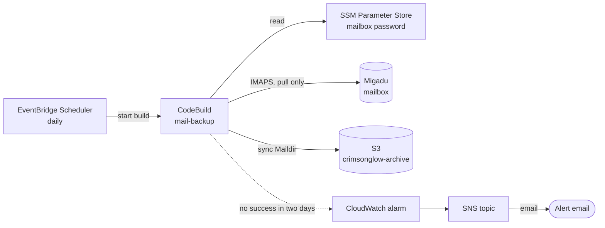

# Architecture

crimsonglow.ca is a static site, a webmail, and a mailbox backup, all in one AWS account in
`ca-central-1` and managed by the Terraform in [`terraform/`](../terraform/). The site is files in
a private S3 bucket behind CloudFront. The webmail is Migadu's open-source Alps running in a
Lambda function. Mail itself is hosted by Migadu, not AWS; AWS holds only the DNS records that
point at it and a nightly copy of every mailbox.

## Serving

- **Site.** CloudFront serves every page from the private bucket; only CloudFront can read it
  (origin access control). Before each request reaches the bucket, the router function sends `/`
  to `/~kjiwa/`, `www` to the apex, and each legacy path in
  [`site/_data/redirects.yml`](../site/_data/redirects.yml) to its new address, and maps a
  trailing `/` to `index.html`. A missing page returns the site's own 404. A response-headers
  policy adds HSTS, a content security policy and the other security headers.
- **Webmail.** API Gateway fronts a single Lambda function that runs Alps behind the Lambda Web
  Adapter. Alps keeps no state: it signs in to Migadu over IMAP and SMTP and stores a user's
  settings in the mailbox. The stage allows 10 requests per second, burst 20. Setup and
  operation: [`MAIL.md`](MAIL.md).
- **Mail delivery.** MX records point at Migadu; SPF, DKIM and DMARC records in the same zone
  authorise it. AWS never sees a message in transit.

## Deploying

- **Content** deploys itself. Every push to `main` that passes the build and the shared
  `privacy` workflow syncs the built site to S3, invalidates CloudFront and uploads the webmail bundle. GitHub proves its identity to AWS
  with an OIDC token; the `github-deploy` role trusts only this repository's `main` branch and
  can only write the site bucket, invalidate this distribution and update the webmail function.
  No long-lived AWS key exists.
- **Infrastructure** is applied by hand: `scripts/tf.sh apply` with an administrator profile.
  CI runs only `fmt`, `init -backend=false` and `validate` on the Terraform. The state lives in
  its own versioned bucket.

## Mail backup

Migadu does not promise to keep a terminated account's mail, so a copy lives where this account
controls it. The pull never deletes; the archive bucket is versioned and keeps replaced and
deleted objects for 365 days. The alarm treats missing data as failure, so a job that stopped
running alerts the same as one that fails. Alert addresses must not use this domain, because a
mail outage would silence the alert. Setup and restore: [`MAIL.md`](MAIL.md).

## What is deployed

| Role | Service | Resource | Purpose |
|---|---|---|---|
| DNS | Route 53 | Hosted zone `crimsonglow.ca` and its records | Apex and `www` alias to CloudFront, `mail` alias to API Gateway, MX, SPF, DKIM, DMARC |
| Site | CloudFront | One distribution for the apex and `www` | Serves the site |
| Site | CloudFront | Router function, response-headers policy, origin access control | Redirects and index pages; security headers; private bucket access |
| Site | S3 | `crimsonglow-site` | Built site, private, readable only by CloudFront |
| Site | ACM | Certificate for apex and `www`, in `us-east-1` | CloudFront accepts certificates only from that region |
| Webmail | API Gateway | HTTP API, custom domain `mail.crimsonglow.ca`, throttled stage | Public entry to the webmail |
| Webmail | ACM | Regional certificate for `mail` | TLS for the custom domain |
| Webmail | Lambda | Function `webmail` with the Lambda Web Adapter layer | Runs Alps; code is uploaded by CI |
| Webmail | CloudWatch Logs | Log group `/aws/lambda/webmail` | Function logs |
| Mail backup | EventBridge Scheduler | Daily schedule | Starts the build |
| Mail backup | CodeBuild | Project `mail-backup` | Pulls each mailbox with `mbsync` |
| Mail backup | S3 | `crimsonglow-archive`, versioned | The copies and their history |
| Mail backup | SSM Parameter Store | `/mail/<address>/password`, set by `scripts/mail-password.sh`, not in Terraform | IMAP password for the pull |
| Mail backup | CloudWatch, SNS | Alarm `mail-backup`, topic `crimsonglow-alerts`, email subscription | Alerts when the backup stops succeeding |
| Identity | IAM | OIDC provider for GitHub; roles `github-deploy`, `webmail` and two for the backup | CI deploys without keys; each workload gets only what it needs |
| State | S3 | `crimsonglow-tfstate`, versioned | Terraform state and lock |

## Decisions worth knowing

- **API Gateway, not CloudFront, fronts the webmail.** CloudFront's origin access control needs
  a body hash on every POST, so it cannot sit in front of the Lambda function.
- **The apex certificate is in `us-east-1`.** CloudFront reads certificates only from there; the
  provider alias `us_east_1` exists for this one resource family.
- **HSTS has no `includeSubDomains`.** Not every subdomain serves valid HTTPS, so the header
  covers only the host that sent it.
- **Pages carry their stylesheet inline.** The content security policy allows inline styles for
  that reason and nothing else inline: scripts, images and fonts are same-origin only, and the
  one external origin is `docs.google.com`, framed by a post that embeds slides.
- **The login key for the webmail is generated by Terraform.** It is in state, so the state
  bucket is the secret store for it. Rotation signs everyone out.
- **Terraform owns the Lambda placeholder only.** CI replaces the function code on each deploy,
  and Terraform ignores that drift.
